# Rentou App: plano de arquitetura

> **Compare, economize, viaje.**
> Documento vivo. Versão 1.0 (18/11/2026). Escrito como material de estudo: cada decisão vem com teoria, motivo, alternativas, trade-offs e perguntas de revisão.

---

## Sumário

0. [Como ler este documento](#0-como-ler-este-documento)
1. [Visão geral e requisitos](#1-visão-geral-e-requisitos)
2. [Visão de sistema (C4)](#2-visão-de-sistema-c4)
3. [Decisão 1: dois projetos independentes](#3-decisão-1-dois-projetos-independentes)
4. [Decisão 2: monólito modular no backend](#4-decisão-2-monólito-modular-no-backend)
5. [Decisão 3: portas e adaptadores para as locadoras (`RentalProvider`)](#5-decisão-3-portas-e-adaptadores-para-as-locadoras-rentalprovider)
6. [Decisão 4: consulta paralela com timeout e resultados parciais](#6-decisão-4-consulta-paralela-com-timeout-e-resultados-parciais)
7. [Decisão 5: camada de normalização (catálogo canônico)](#7-decisão-5-camada-de-normalização-catálogo-canônico)
8. [Decisão 6: equivalência e "Melhor oferta"](#8-decisão-6-equivalência-e-melhor-oferta)
9. [Decisão 7: dinheiro, datas e diárias](#9-decisão-7-dinheiro-datas-e-diárias)
10. [Decisão 8: cálculo de preço no servidor (cotação)](#10-decisão-8-cálculo-de-preço-no-servidor-cotação)
11. [Contratos da API REST](#11-contratos-da-api-rest)
12. [DTOs, validação e tratamento padronizado de erros](#12-dtos-validação-e-tratamento-padronizado-de-erros)
13. [Modelo de dados (PostgreSQL)](#13-modelo-de-dados-postgresql)
14. [Dados simulados (modo demonstração)](#14-dados-simulados-modo-demonstração)
15. [Integrações oficiais futuras](#15-integrações-oficiais-futuras)
16. [Arquitetura do frontend](#16-arquitetura-do-frontend)
17. [Estratégia de testes](#17-estratégia-de-testes)
18. [Requisitos transversais: segurança, observabilidade, performance](#18-requisitos-transversais-segurança-observabilidade-performance)
19. [Roadmap em fases](#19-roadmap-em-fases)
20. [Registro de decisões (ADRs)](#20-registro-de-decisões-adrs)
21. [Avaliação final do módulo](#21-avaliação-final-do-módulo)

---

## 0. Como ler este documento

Cada decisão importante segue o mesmo roteiro, que é o roteiro que um Staff Engineer usa ao escrever uma proposta técnica:

1. **Teoria**: o conceito por trás.
2. **Por que existe / que problema resolve.**
3. **A decisão para o Rentou.**
4. **Alternativas consideradas.**
5. **Trade-offs**: manutenção, escalabilidade, performance, complexidade.
6. **Quando NÃO usar.**
7. **Erros comuns.**
8. **Perguntas de revisão**: responda antes de seguir. Se não conseguir, releia a seção.

Uma regra que vale para o documento inteiro: **arquitetura é a arte de escolher quais problemas você aceita ter.** Não existe decisão sem custo. Se alguém te apresenta uma solução sem desvantagens, ainda não entendeu a solução.

---

## 1. Visão geral e requisitos

### 1.1 O produto

O Rentou consulta três locadoras (Localiza, Movida, Unidas) ao mesmo tempo, mostra as ofertas lado a lado, identifica a **melhor oferta entre ofertas equivalentes**, permite **personalizar proteções e adicionais** com recálculo de preço e **redireciona** o usuário para a locadora. Na V1 **não há reserva nem pagamento** e os preços são **simulados**.

### 1.2 Requisitos funcionais (RF)

| ID | Requisito |
|---|---|
| RF01 | Pesquisar por local/data/hora de retirada e devolução e idade do condutor |
| RF02 | Permitir devolução em loja diferente |
| RF03 | Consultar as três locadoras e listar ofertas |
| RF04 | Filtrar por categoria, câmbio, ar-condicionado, passageiros, carroceria |
| RF05 | Marcar "Melhor oferta" apenas entre ofertas equivalentes e mostrar a economia |
| RF06 | Personalizar proteções, adicionais e quilometragem com recálculo automático |
| RF07 | Informar quando não houver equivalência confirmada entre produtos |
| RF08 | Exibir detalhes completos da oferta |
| RF09 | Redirecionar para a página de reserva da locadora, quando houver |
| RF10 | Deixar explícito que os preços são demonstrativos |

### 1.3 Requisitos não funcionais (RNF)

| ID | Requisito | Meta inicial |
|---|---|---|
| RNF01 | Tempo de resposta da busca | p95 < 3 s com integrações reais; < 500 ms em modo demo |
| RNF02 | Resiliência | Falha de uma locadora não derruba a busca (resultado parcial) |
| RNF03 | Extensibilidade | Nova locadora sem alterar a lógica de comparação (Open/Closed) |
| RNF04 | Correção monetária | Nenhum cálculo com `double`; arredondamento definido |
| RNF05 | Transparência | Nunca afirmar equivalência que não foi confirmada |
| RNF06 | Responsividade | Mobile e desktop |
| RNF07 | Testabilidade | Regras de domínio testáveis sem Spring e sem banco |

> **Lição:** RNFs são o que realmente define a arquitetura. RF01 a RF10 poderiam ser atendidos por um script. São RNF02, RNF03 e RNF05 que nos obrigam a pensar em portas/adaptadores, paralelismo e normalização.

### 1.4 Glossário (linguagem ubíqua)

Usar as mesmas palavras no código, na conversa e na interface é um princípio do DDD chamado **linguagem ubíqua**. Ele evita que "plano", "pacote" e "proteção" signifiquem coisas diferentes para pessoas diferentes.

| Termo | Significado |
|---|---|
| **Provider / Locadora** | Empresa consultada (Localiza, Movida, Unidas) |
| **Busca (Search)** | Um pedido do usuário com critérios; gera várias ofertas |
| **Oferta (Offer)** | Um carro de uma categoria, de uma locadora, para um período, com um preço base |
| **Diária** | Unidade de cobrança (normalmente blocos de 24h) |
| **Produto do provider** | Proteção ou adicional com o nome comercial da locadora |
| **Produto canônico** | Proteção ou adicional no vocabulário do Rentou (ex.: `PROTECTION_FULL`) |
| **Mapeamento** | Ligação entre um produto do provider e um canônico, com um nível de confiança |
| **Grupo de equivalência** | Conjunto de ofertas comparáveis entre si |
| **Cotação (Quote)** | Preço final de uma oferta após a seleção de proteções e adicionais |

### Perguntas de revisão (seção 1)

1. Dê um exemplo de RNF que, se ignorado, faria você reescrever o sistema depois.
2. Por que "Melhor oferta" é um requisito de *corretude*, e não só de interface?
3. Qual a diferença entre "produto do provider" e "produto canônico"? Por que precisamos dos dois?

---

## 2. Visão de sistema (C4)

O **modelo C4** (Simon Brown) descreve software em quatro níveis de zoom: Contexto, Containers, Componentes e Código. Ele existe porque diagramas sem nível definido misturam detalhes de implantação com classes e ninguém entende nada.

### 2.1 Nível 1: Contexto

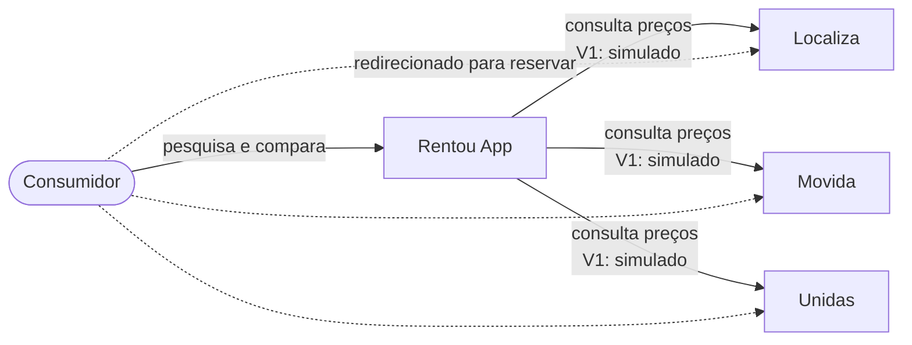

### 2.2 Nível 2: Containers

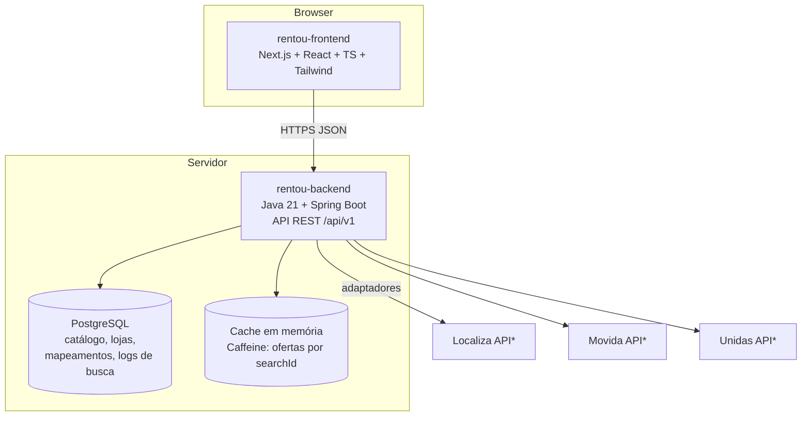

\* Na V1 os adaptadores leem dados simulados. As APIs oficiais só entram mediante credenciais e acordo comercial (seção 15).

### 2.3 Nível 3: Componentes do backend

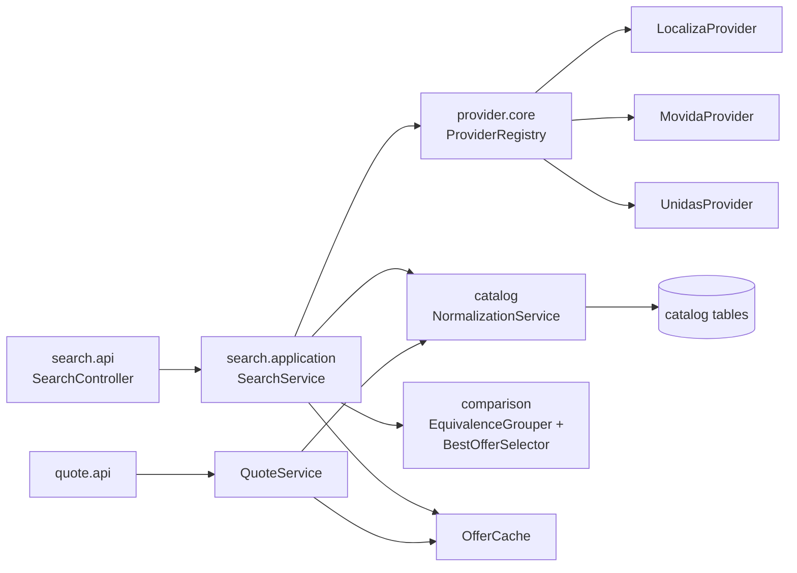

### Perguntas de revisão (seção 2)

1. Em qual nível do C4 você desenharia a interface `RentalProvider`? E o PostgreSQL?
2. Por que o cache aparece como container separado do banco?

---

## 3. Decisão 1: dois projetos independentes

### Teoria

Existem duas formas clássicas de organizar repositórios:

- **Polyrepo**: um repositório por aplicação.
- **Monorepo**: várias aplicações no mesmo repositório (Google, Meta), geralmente com ferramentas como Nx, Turborepo ou Bazel.

Independente do repositório, o importante é o **desacoplamento por contrato**: o frontend só conhece o backend pelo contrato HTTP (OpenAPI), nunca por código compartilhado.

### Decisão

- Um repositório (`rentouapp-web`) com **dois projetos independentes** em pastas na raiz:
  - `rentou-frontend/`: Next.js, com `package.json` próprio.
  - `rentou-backend/`: Spring Boot, com `pom.xml` (ou Gradle) próprio.
- Cada projeto tem **build, testes, Dockerfile e pipeline de CI próprios** (workflows do GitHub Actions filtrados por `paths:`). Nenhum importa código do outro.
- O contrato é um arquivo **OpenAPI** gerado pelo backend (springdoc) e consumido pelo frontend para gerar tipos TypeScript (`openapi-typescript`).

Isso é um "monorepo leve": ganhamos PRs atômicos (mudar contrato e frontend juntos) sem adotar ferramentas de monorepo. Se um dia os projetos precisarem de ciclos totalmente separados, cada pasta pode virar um repositório com `git filter-repo`, preservando o histórico.

### Alternativas e trade-offs

| Critério | Pastas independentes num repo (escolhido) | Polyrepo | Monorepo com ferramentas (Nx/Turborepo) |
|---|---|---|---|
| Manutenção | PR atômico front+back; CI separado por pasta | CI e versão totalmente independentes | PR atômico + cache de build |
| Escalabilidade de time | Boa para um time pequeno | Times donos de repos | Escala para muitos times, com investimento |
| Complexidade | Baixa | Baixa, mas exige coordenar versões entre repos | Média/alta |
| Risco | Acoplamento acidental (importar arquivo do outro lado) | Contrato desalinhado entre repos | Ferramenta vira um projeto em si |

**Por que assim:** stacks diferentes (Node e JVM) quase não compartilham ferramentas de build, então Nx/Turborepo não trariam muito; mas manter tudo junto deixa o contrato e o frontend evoluírem no mesmo PR, o que é valioso enquanto a API ainda está mudando.

**Mitigação dos riscos:** regra de que nenhuma pasta referencia arquivos da outra, testes de contrato (seção 17) e tipos gerados a partir do OpenAPI.

### Quando NÃO usar esta abordagem

Com vários times que precisam de permissões, releases e ritmos diferentes, repositórios separados ficam mais simples. No outro extremo, com muitas bibliotecas internas compartilhadas por vários apps (um design system, por exemplo), um monorepo com ferramentas evita o "inferno de versões".

### Erros comuns

- Copiar à mão os tipos do backend para o frontend: eles divergem em semanas.
- Criar um pacote "shared" com DTOs usado pelos dois lados: reintroduz o acoplamento que você queria evitar.

### Perguntas de revisão (seção 3)

1. O que é "desacoplamento por contrato"? Dê um exemplo de como ele quebra.
2. Em qual cenário você separaria o Rentou em dois repositórios? E em qual adotaria Nx/Turborepo?

---

## 4. Decisão 2: monólito modular no backend

### Teoria

Um **monólito modular** é uma única aplicação implantável, dividida internamente em módulos com fronteiras explícitas (pacotes, visibilidade, regras de dependência). É o meio-termo entre o "monólito bola de lama" e os **microsserviços**.

A regra de ouro: **módulos conversam por interfaces públicas, nunca pelas classes internas uns dos outros.** Se isso for respeitado, extrair um módulo para um microsserviço no futuro é uma mudança de transporte (chamada de método vira HTTP ou mensagem), não uma reescrita.

### Por que existe

Microsserviços resolvem problemas de **organização** (muitos times precisando implantar de forma independente) e de **escala heterogênea** (uma parte precisa de 50 instâncias, outra de 2). Eles cobram caro: rede, consistência eventual, observabilidade distribuída, deploy coordenado. Um time de uma pessoa não tem os problemas que justificam esse custo.

### Decisão

Um único `rentou-backend` com organização **por funcionalidade (package by feature)** e camadas internas leves em cada módulo:

```
com.rentou
├── RentouApplication.java
├── shared/                        # utilidades transversais, sem regra de negócio
│   ├── money/      Money, Currency helpers
│   ├── time/       RentalPeriod, ClockConfig
│   ├── error/      ApiException, ErrorCode, GlobalExceptionHandler
│   └── config/     CorsConfig, CacheConfig, OpenApiConfig
├── location/                      # lojas e cidades
│   ├── api/        LocationController, LocationResponse
│   ├── application/LocationService
│   └── infra/      LocationRepository, LocationEntity
├── catalog/                       # normalização de proteções e adicionais
│   ├── domain/     CanonicalProduct, ProductMapping, EquivalenceLevel
│   ├── application/NormalizationService
│   └── infra/      repositórios JPA, entidades
├── provider/                      # integrações com locadoras
│   ├── core/       RentalProvider (porta), ProviderRegistry, ProviderQuery,
│   │               ProviderOffer, ProviderProduct, ProviderException
│   ├── localiza/   LocalizaProvider, LocalizaMapper, LocalizaClient,
│   │               LocalizaMockSource, LocalizaProperties
│   ├── movida/     ...
│   └── unidas/     ...
├── search/                        # orquestração da busca
│   ├── api/        SearchController, SearchRequest, SearchResponse
│   ├── application/SearchService, ProviderFanOut
│   └── domain/     SearchCriteria, Offer, OfferId
├── comparison/                    # regras de equivalência e melhor oferta
│   └── domain/     EquivalenceKey, EquivalenceGrouper, BestOfferSelector,
│                   ComparisonGroup
└── quote/                         # personalização e recálculo
    ├── api/        QuoteController, QuoteRequest, QuoteResponse
    ├── application/QuoteService
    └── domain/     Quote, PriceBreakdown, PricingRules
```

**Regras de dependência** (verificadas com ArchUnit, seção 17):

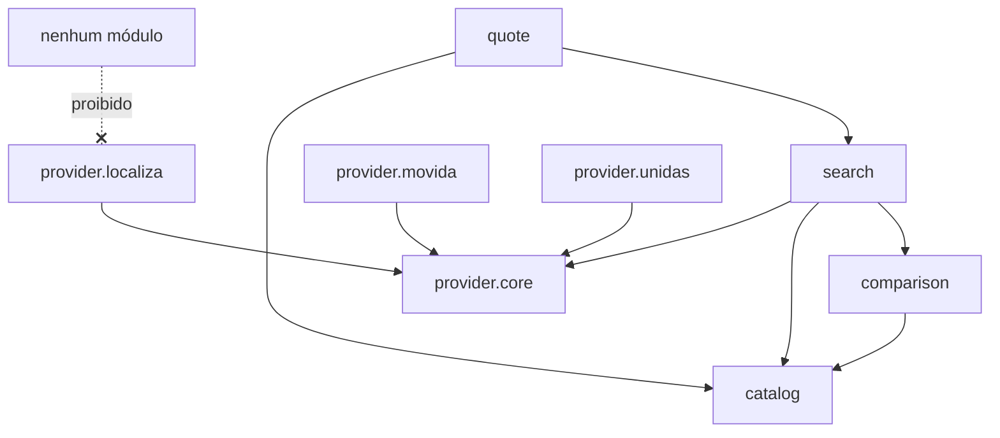

- Nenhum módulo importa `provider.localiza`, `provider.movida` ou `provider.unidas`. Só o Spring os conhece (via injeção).
- `domain` não importa Spring, JPA nem Jackson. É Java puro.
- `api` (controllers e DTOs) nunca é importado por outros módulos.

### Por que package by feature e não by layer?

Package by layer (`controller/`, `service/`, `repository/`) espalha uma funcionalidade por todo o projeto. Para entender "cotação" você abre quatro pastas. Package by feature agrupa o que muda junto (princípio de **coesão**: *Common Closure Principle*). E permite usar a visibilidade `package-private` do Java para esconder detalhes de implementação, algo impossível quando tudo precisa ser `public` para atravessar pastas.

### Por que não Clean/Hexagonal "completa" em todo módulo?

Porque `location` é praticamente um CRUD de leitura. Colocar portas, casos de uso e mapeadores ali é cerimônia sem benefício. Aplicamos hexagonal **onde há variação real**: as locadoras (seção 5). Isso é arquitetura pragmática: o nível de abstração deve ser proporcional à volatilidade.

### Trade-offs

| Critério | Monólito modular (escolhido) | Microsserviços | Monólito sem módulos |
|---|---|---|---|
| Manutenção | Boa, se as fronteiras forem vigiadas | Boa por serviço, difícil no todo | Degrada rápido |
| Escalabilidade | Escala horizontal da aplicação inteira (stateless) | Escala por serviço | Igual ao modular |
| Performance | Chamadas em memória | Latência de rede entre serviços | Igual ao modular |
| Complexidade | Baixa/média | Alta (rede, tracing, deploy, dados distribuídos) | Baixa no início, alta depois |
| Evolução | Extração gradual possível | Já está distribuído | Reescrita |

### Quando NÃO usar

Quando partes do sistema têm requisitos de escala ou de disponibilidade muito diferentes, ou quando há vários times que precisam implantar em ritmos distintos. Um candidato natural à extração futura no Rentou é o `provider` (pode virar um "Provider Gateway" com escala e limites de taxa próprios).

### Erros comuns

- Módulos que compartilham entidades JPA: um módulo altera a tabela do outro e as fronteiras somem.
- "Service" gigante com 40 métodos. Prefira serviços pequenos por caso de uso.
- Achar que pastas bastam. Sem verificação automática (ArchUnit ou Spring Modulith), as regras são quebradas em um mês.

### Perguntas de revisão (seção 4)

1. Que problema os microsserviços resolvem que o Rentou ainda não tem?
2. Por que `domain` não deve depender do Spring? O que você ganha em testes?
3. Se amanhã o módulo `provider` virasse um serviço separado, o que mudaria no `search`?

---

## 5. Decisão 3: portas e adaptadores para as locadoras (`RentalProvider`)

### Teoria

**Arquitetura Hexagonal** (Alistair Cockburn, "Ports and Adapters"): o núcleo da aplicação define **portas** (interfaces) do que precisa do mundo externo; **adaptadores** implementam essas portas para tecnologias específicas. O núcleo não sabe se o preço veio de uma API REST, SOAP, arquivo ou mock.

Ela combina três princípios do SOLID:

- **DIP (Dependency Inversion)**: o `SearchService` depende da abstração `RentalProvider`, não de `LocalizaClient`.
- **OCP (Open/Closed)**: adicionar uma quarta locadora é criar uma nova classe, sem editar o `SearchService`.
- **LSP (Liskov)**: qualquer `RentalProvider` precisa honrar o mesmo contrato (ex.: devolver preços em BRL, lançar `ProviderException` em falha, respeitar o timeout).

E dois padrões de projeto:

- **Strategy**: cada provider é uma estratégia intercambiável de "buscar ofertas".
- **Registry**: o Spring injeta `List<RentalProvider>` e o `ProviderRegistry` expõe os habilitados.

E um padrão de DDD: **Anti-Corruption Layer (ACL)**. O modelo de dados de cada locadora (nomes, códigos, estruturas estranhas) é traduzido no adaptador e nunca vaza para o domínio do Rentou.

### A porta

```java
package com.rentou.provider.core;

/**
 * Porta de saída para consulta de ofertas em uma locadora.
 * Contrato:
 *  - Valores monetários sempre em BRL.
 *  - Nunca retorna null; lista vazia significa "sem disponibilidade".
 *  - Falhas de integração viram ProviderException (nunca exceções da biblioteca HTTP).
 *  - Deve ser thread-safe: é chamada em paralelo.
 */
public interface RentalProvider {

    ProviderId id();                       // LOCALIZA, MOVIDA, UNIDAS...

    ProviderMetadata metadata();           // nome de exibição, logo, site

    boolean supports(ProviderQuery query); // ex.: atende essa cidade? aceita essa idade?

    List<ProviderOffer> search(ProviderQuery query) throws ProviderException;
}
```

`ProviderId` é um **value object** e não um `enum`. Com `enum`, adicionar uma locadora exige editar o enum, o que viola o OCP que queremos garantir:

```java
public record ProviderId(String value) {
    public ProviderId {
        if (value == null || !value.matches("[A-Z_]{2,30}"))
            throw new IllegalArgumentException("ProviderId inválido: " + value);
    }
}
```

### O modelo do provider (saída do adaptador, já sem "sotaque")

```java
public record ProviderOffer(
        ProviderId provider,
        String providerOfferRef,          // id opaco da locadora
        VehicleSpec vehicle,
        RentalPeriod period,
        Money dailyRate,
        int rentalDays,
        List<ProviderProduct> includedProducts,   // proteção inclusa etc.
        List<ProviderProduct> optionalProducts,   // adicionais disponíveis
        List<Fee> fees,                           // taxa de retorno, taxa administrativa...
        MileagePolicy mileage,
        FuelPolicy fuelPolicy,
        Optional<CancellationPolicy> cancellation,
        Optional<URI> bookingUrl) {}

public record ProviderProduct(
        String providerCode,     // "PROT_SUPER" — código comercial da locadora
        String displayName,      // "Proteção Super" — só para exibir
        ProductKind kind,        // PROTECTION, ADDON
        Money price,
        PriceUnit unit) {}       // PER_DAY, PER_RENTAL
```

Repare: **nenhum campo diz "isto é proteção completa"**. Essa interpretação é responsabilidade da camada de normalização (seção 7), não do adaptador. Separar "traduzir formato" (adaptador) de "interpretar significado" (catálogo) é o que permite auditar e corrigir mapeamentos sem tocar em código de integração.

### Estrutura de um adaptador

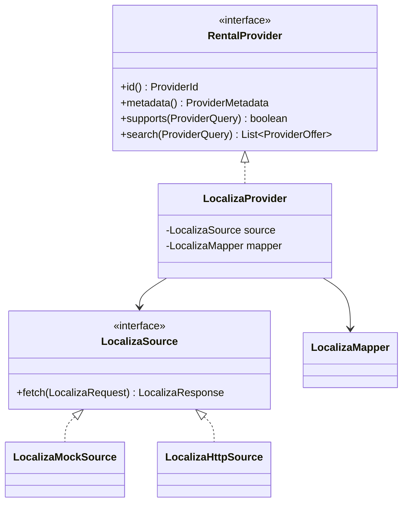

Cada adaptador tem **duas camadas internas**:

- `LocalizaSource`: de onde vêm os dados brutos (mock agora, HTTP oficial depois). O formato é o **da locadora** (`LocalizaResponse`).
- `LocalizaMapper`: traduz `LocalizaResponse` para `ProviderOffer`.

Assim, o mock exercita o **mesmo mapper** que a integração real vai usar. Quando a API oficial chegar, troca-se só o `Source`. Isso é muito melhor do que um mock que já devolve `ProviderOffer` pronto, porque testa a tradução de verdade.

Seleção por configuração:

```yaml
rentou:
  providers:
    localiza:
      enabled: true
      mode: mock        # mock | official
      timeout: 2s
    movida:
      enabled: true
      mode: mock
    unidas:
      enabled: true
      mode: mock
```

```java
@Configuration
class LocalizaConfig {
    @Bean
    @ConditionalOnProperty(name = "rentou.providers.localiza.mode", havingValue = "mock", matchIfMissing = true)
    LocalizaSource localizaMockSource(MockScenarioEngine engine) { return new LocalizaMockSource(engine); }

    @Bean
    @ConditionalOnProperty(name = "rentou.providers.localiza.mode", havingValue = "official")
    LocalizaSource localizaHttpSource(RestClient.Builder builder, LocalizaProperties props) {
        return new LocalizaHttpSource(builder, props);
    }
}
```

### Alternativas

| Alternativa | Por que não |
|---|---|
| `if (provider == LOCALIZA) ... else if ...` no serviço | Viola OCP; cada locadora nova mexe no núcleo e arrisca as outras |
| Classe abstrata `AbstractRentalProvider` com template method | Útil se houver muito comportamento comum. Começamos com interface + composição; extraímos base comum só se surgir duplicação real (regra de três) |
| Plugins carregados em runtime (ServiceLoader, JARs externos) | Complexidade desnecessária; não precisamos adicionar locadoras sem redeploy |

### Trade-offs

- **Manutenção:** excelente isolamento. Uma mudança na API da Movida não toca em Localiza nem no núcleo.
- **Escalabilidade:** permite, no futuro, mover os adaptadores para um serviço separado sem mudar o núcleo.
- **Performance:** a indireção da interface custa nada mensurável. O custo real é o mapeamento de objetos, desprezível perto da latência de rede.
- **Complexidade:** mais classes por locadora (Provider, Source, Mapper, Properties, DTOs da locadora). É o preço do isolamento.

### Erros comuns

- Deixar DTOs da locadora (ex.: `LocalizaVehicleDto`) aparecerem no `SearchService`. A ACL deixa de existir.
- Interface "gorda" com métodos que só uma locadora suporta (`getLocalizaPoints()`). Viola o **ISP**. Capacidades opcionais devem ser interfaces separadas (`SupportsDeepLink`, por exemplo) ou dados em `metadata()`.
- Implementação que retorna `null` ou lança `RuntimeException` genérica, quebrando o contrato (LSP).

### Perguntas de revisão (seção 5)

1. Explique com suas palavras como DIP e OCP aparecem no `RentalProvider`.
2. Por que `ProviderId` é record e não enum? Qual princípio isso protege?
3. Por que o mapper fica no adaptador, mas a interpretação "isto é proteção completa" fica no catálogo?
4. Como você testaria o `LocalizaMapper` sem subir o Spring?

---

## 6. Decisão 4: consulta paralela com timeout e resultados parciais

### Teoria

Consultar N serviços externos é um problema de **fan-out / fan-in** (scatter-gather). Se cada locadora leva ~1 s, sequencialmente gastamos 3 s; em paralelo, ~1 s (o tempo da mais lenta). Mas paralelismo traz duas perguntas: **quanto esperar** (timeout) e **o que fazer se alguém falhar** (degradação graciosa).

Java 21 trouxe **virtual threads** (Project Loom): threads leves, gerenciadas pela JVM, que tornam barato bloquear em I/O. Isso permite escrever código bloqueante simples e ainda assim escalar para milhares de chamadas concorrentes, sem a complexidade de programação reativa.

### Decisão

```java
@Service
class ProviderFanOut {
    private final ProviderRegistry registry;
    private final ExecutorService executor = Executors.newVirtualThreadPerTaskExecutor();
    private final Duration globalTimeout;

    FanOutResult searchAll(ProviderQuery query) {
        List<RentalProvider> providers = registry.enabledFor(query);

        Map<ProviderId, Future<List<ProviderOffer>>> futures = providers.stream()
            .collect(toMap(RentalProvider::id, p -> executor.submit(() -> p.search(query))));

        Instant deadline = Instant.now().plus(globalTimeout);
        var results = new ArrayList<ProviderResult>();
        futures.forEach((id, future) -> results.add(await(id, future, deadline)));
        return new FanOutResult(results);
    }

    private ProviderResult await(ProviderId id, Future<List<ProviderOffer>> f, Instant deadline) {
        try {
            long remaining = Math.max(0, Duration.between(Instant.now(), deadline).toMillis());
            return ProviderResult.ok(id, f.get(remaining, MILLISECONDS));
        } catch (TimeoutException e) {
            f.cancel(true);
            return ProviderResult.failed(id, ProviderStatus.TIMEOUT);
        } catch (ExecutionException e) {
            return ProviderResult.failed(id, ProviderStatus.ERROR);
        } catch (InterruptedException e) {
            Thread.currentThread().interrupt();
            return ProviderResult.failed(id, ProviderStatus.ERROR);
        }
    }
}
```

A resposta da busca sempre traz o status por locadora:

```json
"providers": [
  { "id": "LOCALIZA", "status": "OK", "offerCount": 6 },
  { "id": "MOVIDA",   "status": "TIMEOUT", "offerCount": 0 },
  { "id": "UNIDAS",   "status": "OK", "offerCount": 5 }
]
```

E o frontend mostra: "Não conseguimos consultar a Movida agora. Mostrando resultados de 2 de 3 locadoras."

**Atenção à corretude:** com uma locadora ausente, a "Melhor oferta" é a melhor *entre as consultadas*. O texto da economia deve deixar isso claro, para não enganar o usuário.

### Alternativas

| Alternativa | Trade-off |
|---|---|
| Sequencial | Simples, mas latência soma. Inaceitável com 3+ locadoras |
| `CompletableFuture` com pool fixo | Funciona bem; exige dimensionar o pool e cuidar de bloqueio. Era o padrão antes do Java 21 |
| WebFlux / Reactor | Ótima escalabilidade, mas muda todo o estilo de programação (operadores, debugging difícil, contaminação reativa). Não se paga aqui |
| Structured Concurrency (`StructuredTaskScope`) | O modelo mais elegante para scatter-gather, cancela filhos automaticamente. Ainda era *preview* em versões anteriores; adotar quando estiver estável na versão de Java usada |
| Busca assíncrona com polling/SSE (resultados chegam aos poucos, como no Kayak) | Melhor UX com integrações lentas, mais complexidade (estado da busca no servidor, streaming). Candidata à Fase 4 |

### Trade-offs

- **Performance:** latência ≈ max(locadoras), limitada pelo timeout global.
- **Escalabilidade:** virtual threads aguentam muitas buscas simultâneas com pouco consumo de memória. O gargalo passa a ser os limites de taxa das locadoras, e por isso entra cache (seção 18).
- **Manutenção:** código imperativo, fácil de ler e depurar.
- **Complexidade:** precisamos lidar com cancelamento, interrupção e resultados parciais, e testá-los.

### Erros comuns

- Usar `parallelStream()` para I/O: ele usa o `ForkJoinPool.commonPool`, compartilhado com toda a JVM e dimensionado para CPU.
- Não ter timeout: uma locadora lenta trava a busca inteira.
- Engolir a exceção sem log nem métrica: você nunca descobre que a Unidas falha em 30% das buscas.
- Usar `synchronized` pesado dentro de código em virtual threads (até o Java 24 isso podia "fixar" a thread virtual na thread de plataforma). Prefira `ReentrantLock` se precisar de lock.

### Perguntas de revisão (seção 6)

1. Por que virtual threads são boas para I/O e não ajudam em cálculo pesado de CPU?
2. Qual o problema de usar `parallelStream()` para chamar APIs?
3. Uma locadora respondeu com timeout. Como isso afeta o selo "Melhor oferta"?
4. Quando valeria a pena trocar a resposta única por streaming de resultados?

---

## 7. Decisão 5: camada de normalização (catálogo canônico)

Esta é a parte mais importante e mais delicada do Rentou. É onde está o valor do produto e o maior risco de enganar o usuário.

### O problema

Cada locadora vende produtos parecidos com nomes, coberturas e regras diferentes. Exemplos fictícios:

| Locadora | Nome comercial | O que cobre (fictício) |
|---|---|---|
| A | "Proteção Super" | Roubo, colisão; franquia R$ 2.000 |
| B | "Proteção Total" | Roubo, colisão, vidros; franquia zero |
| C | "Proteção Total" | Roubo, colisão; franquia R$ 1.500 |

"Proteção Total" de B e C têm o **mesmo nome e coberturas diferentes**. Comparar pelo nome seria mentir para o usuário. O requisito é explícito: *nunca considerar dois produtos equivalentes só porque os nomes são parecidos*.

### Teoria

Este é um problema clássico de **integração de dados**: *canonical data model* (modelo de dados canônico). Em vez de comparar N locadoras entre si (N² comparações), cada uma é mapeada para **um vocabulário central** (N mapeamentos). É o mesmo princípio de um conector padrão.

A segunda ideia é **equivalência baseada em atributos, não em rótulos**. Um produto é descrito pelas suas propriedades verificáveis (coberturas, franquia, unidade de preço). Equivalência é uma regra sobre essas propriedades, revisada por uma pessoa.

### Modelo

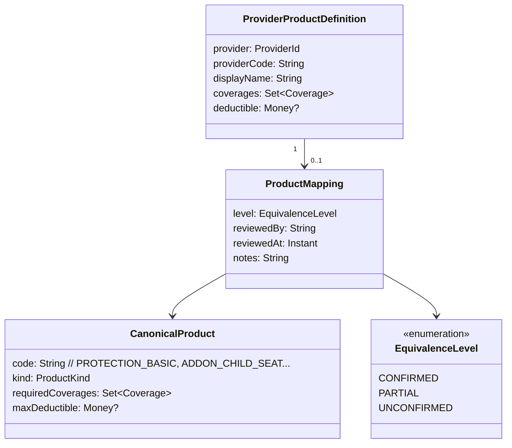

Catálogo canônico inicial (do requisito):

| Código canônico | Tipo | Critério mínimo (exemplo) |
|---|---|---|
| `PROTECTION_BASIC` | Proteção | Roubo e furto + colisão com franquia |
| `PROTECTION_INTERMEDIATE` | Proteção | Básica + franquia reduzida (≤ limite definido) |
| `PROTECTION_FULL` | Proteção | Intermediária + vidros/pneus + franquia ≤ limite |
| `PROTECTION_THIRD_PARTY` | Proteção | Danos a terceiros |
| `ADDON_EXTRA_DRIVER` | Adicional | Condutor adicional |
| `ADDON_CHILD_SEAT` | Adicional | Cadeirinha |
| `ADDON_INFANT_SEAT` | Adicional | Bebê conforto |
| `ADDON_BOOSTER_SEAT` | Adicional | Assento de elevação |
| `ADDON_GPS` | Adicional | GPS |
| `ADDON_WIFI` | Adicional | Wi-Fi (quando houver) |
| `MILEAGE_UNLIMITED` | Quilometragem | Km livre |
| `MILEAGE_LIMITED` | Quilometragem | Km controlada (com franquia diária de km) |
| `ONE_WAY_RETURN` | Taxa | Devolução em outra loja |

### Os três níveis de equivalência

| Nível | Significado | O que a interface faz |
|---|---|---|
| `CONFIRMED` | Atributos verificados e revisados por uma pessoa; atende ao critério canônico | Compara preços normalmente |
| `PARTIAL` | Atende ao critério mínimo, mas com diferença relevante (ex.: franquia maior) | Compara, com aviso: "Cobertura semelhante, franquia diferente" |
| `UNCONFIRMED` | Sem mapeamento revisado, ou atributos desconhecidos | **Não compara**. Mostra: "Não confirmamos equivalência deste item nesta locadora" |

Ausência de mapeamento é **sempre** `UNCONFIRMED`. O sistema é *fail-safe*: na dúvida, não afirma.

### Como o mapeamento é criado

1. O adaptador entrega `ProviderProduct` com `providerCode` e os atributos que a locadora informa.
2. `NormalizationService` procura `ProductMapping` para (provider, providerCode).
3. Não achou: `UNCONFIRMED` e registra um evento/log "produto não mapeado" para revisão.
4. Uma pessoa revisa os termos da locadora e cadastra o mapeamento com nível, notas e data. **Mapeamento é dado, não código**, então vive no banco e pode ser corrigido sem deploy.
5. Opcional (fase futura): uma regra automática pode *sugerir* um nível comparando atributos, mas só a revisão humana promove para `CONFIRMED`.

```java
public final class NormalizationService {
    public NormalizedProduct normalize(ProviderId provider, ProviderProduct product) {
        return mappingRepository.find(provider, product.providerCode())
            .map(m -> NormalizedProduct.mapped(product, m.canonical(), m.level()))
            .orElseGet(() -> {
                unmappedProducts.record(provider, product);   // métrica + log
                return NormalizedProduct.unconfirmed(product);
            });
    }
}
```

### Alternativas

| Alternativa | Por que não |
|---|---|
| Comparar por nome (ou por similaridade de texto) | Viola explicitamente o requisito; gera falsas equivalências |
| Mapeamento no código (`switch` por código) | Cada correção exige deploy; não registra quem revisou |
| Modelo de ML para classificar produtos | Interessante para *sugerir*, mas inaceitável como verdade sem revisão; difícil explicar a decisão ao usuário |

### Trade-offs

- **Manutenção:** exige processo operacional (alguém revisa mapeamentos). É um custo humano contínuo, e é exatamente o que dá credibilidade ao produto.
- **Escalabilidade:** N mapeamentos em vez de N². Mapeamentos são lidos o tempo todo e mudam pouco, então ficam em cache.
- **Performance:** consulta em memória (cache carregado do banco); custo desprezível.
- **Complexidade:** mais conceitos (canônico, mapeamento, nível). Compensa porque é o coração do negócio. Este é o **core domain** no vocabulário do DDD: onde vale investir mais modelagem.

### Erros comuns

- Tratar `null` como "equivalente por padrão".
- Guardar só o nível, sem notas e data de revisão. Em seis meses ninguém sabe por que algo foi marcado como `CONFIRMED`.
- Esquecer que produtos mudam: mapeamentos devem ter vigência (`valid_from`, `valid_to`) ou serem revisados periodicamente.

### Perguntas de revisão (seção 7)

1. Por que N mapeamentos para um modelo canônico são melhores que comparações N para N?
2. Qual a diferença prática entre `PARTIAL` e `UNCONFIRMED` na interface?
3. Por que o mapeamento fica no banco e não no código?
4. O que é *fail-safe* neste contexto? Dê um exemplo de um sistema *fail-open* perigoso.

---

## 8. Decisão 6: equivalência e "Melhor oferta"

### Regra de negócio

> Só existe "Melhor oferta" **dentro de um grupo de ofertas equivalentes**.

Duas ofertas são equivalentes quando a **chave de equivalência** é igual:

```java
public record EquivalenceKey(
        VehicleCategory category,        // ECONOMICO, COMPACTO, INTERMEDIARIO, SUV, ...
        Transmission transmission,       // MANUAL, AUTOMATIC
        boolean airConditioning,
        int passengers,
        MileageType mileage,             // UNLIMITED, LIMITED (com o limite)
        String includedProtection        // código canônico da proteção inclusa,
                                         // só se o mapeamento for CONFIRMED
) {}
```

Regras:

1. Se a proteção inclusa de uma oferta for `UNCONFIRMED`, ela entra num grupo **só dela** (não compete). A interface mostra a oferta, sem selo, com o aviso de equivalência.
2. Grupo com uma única oferta **não recebe selo** (não há com o que comparar).
3. Dentro de um grupo com 2+ ofertas de **locadoras diferentes**, a de menor **preço total** (não diária!) recebe `bestOffer = true`.
4. Economia = (segundo menor preço total do grupo) − (menor preço total). Usamos o segundo menor, e não o maior, para não inflar a economia. É a comparação honesta: "em relação à próxima melhor opção".
5. Empate: nenhuma ganha selo, ou ambas recebem "Mesmo preço". Não escolher arbitrariamente.
6. Categoria de veículo também passa por normalização: cada locadora usa um código próprio de grupo (como o padrão de mercado ACRISS ou códigos internos), mapeado para `VehicleCategory`.

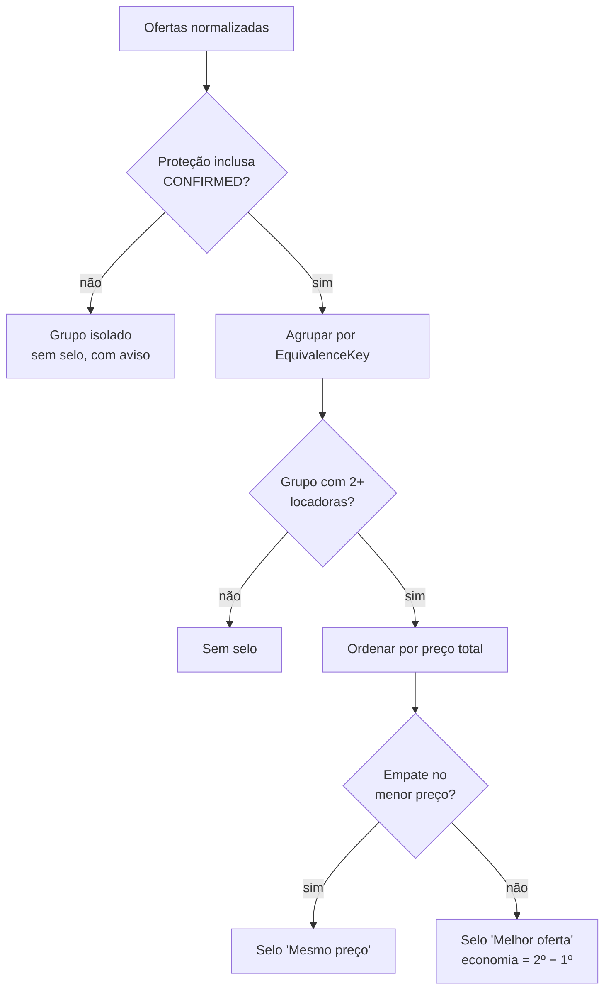

```java
public final class BestOfferSelector {
    public ComparisonGroup select(EquivalenceKey key, List<Offer> offers) {
        if (offers.stream().map(Offer::provider).distinct().count() < 2)
            return ComparisonGroup.withoutWinner(key, offers);

        List<Offer> sorted = offers.stream()
            .sorted(comparing(o -> o.totalPrice().amount()))
            .toList();

        Money best = sorted.get(0).totalPrice();
        Money runnerUp = sorted.get(1).totalPrice();
        if (best.equals(runnerUp)) return ComparisonGroup.tie(key, sorted);

        return ComparisonGroup.winner(key, sorted, sorted.get(0).id(), runnerUp.minus(best));
    }
}
```

Esta classe é **Java puro**: sem Spring, sem banco. É a classe mais importante para testar com exaustão (testes parametrizados com dezenas de cenários).

### Trade-offs da chave de equivalência

- Chave **mais estrita** (muitos campos): menos falsos positivos, mas grupos pequenos e poucos selos.
- Chave **mais frouxa**: mais selos, mais risco de comparar coisas diferentes.

Começamos estritos (alinhado ao requisito) e afrouxamos com dados. Por exemplo, `passengers` pode virar faixa se dois carros de 5 lugares forem considerados equivalentes independentemente de o porta-malas diferir em 20 litros. Essa é uma decisão de **produto**, não técnica, e deve ser registrada.

### Perguntas de revisão (seção 8)

1. Por que comparar pelo preço total e não pela diária?
2. Por que a economia usa o segundo menor preço e não o maior?
3. O que acontece se só a Localiza tiver um SUV automático? Por quê?
4. Escreva três casos de teste para o `BestOfferSelector` antes de olhar o código.

---

## 9. Decisão 7: dinheiro, datas e diárias

### Dinheiro

**Teoria:** `double` e `float` usam ponto flutuante binário (IEEE 754), que não representa exatamente valores como 0,1. `0.1 + 0.2 == 0.30000000000000004`. Em finanças isso gera centavos fantasmas.

**Decisão:**

- Backend: value object `Money` sobre `BigDecimal`, escala 2, `RoundingMode.HALF_EVEN` (arredondamento bancário, que reduz viés acumulado), moeda fixa BRL na V1.
- Arredondar **uma vez, no fim** de cada linha (diária × dias, adicional × dias), e somar as linhas já arredondadas. Documentar isso, porque o total tem que bater com a soma do que o usuário vê.
- JSON: valor como **string decimal** (`"189.90"`) + `currency`. Número JSON vira `double` em JavaScript e perderia a precisão de novo.
- Frontend: formatação com `Intl.NumberFormat('pt-BR', { style: 'currency', currency: 'BRL' })` → `R$ 189,90`. O frontend **não faz contas de dinheiro**; quem calcula é o backend (seção 10).

```java
public record Money(BigDecimal amount, Currency currency) {
    public Money {
        Objects.requireNonNull(amount); Objects.requireNonNull(currency);
        amount = amount.setScale(2, RoundingMode.HALF_EVEN);
    }
    public static Money brl(String value) { return new Money(new BigDecimal(value), Currency.getInstance("BRL")); }
    public Money plus(Money o)  { requireSameCurrency(o); return new Money(amount.add(o.amount), currency); }
    public Money minus(Money o) { requireSameCurrency(o); return new Money(amount.subtract(o.amount), currency); }
    public Money times(int n)   { return new Money(amount.multiply(BigDecimal.valueOf(n)), currency); }
    // equals de record compara BigDecimal com equals: escala igual garantida no construtor
}
```

**Erro comum:** `new BigDecimal(0.1)` (com double) já nasce errado. Use `new BigDecimal("0.1")` ou `BigDecimal.valueOf(0.1)`.

### Datas e horários

- Retirada e devolução são **horário local da loja**. Use `LocalDateTime` + o fuso da loja (`ZoneId`, `America/Sao_Paulo` por padrão; o Brasil tem outros fusos, como Manaus e Fernando de Noronha).
- JSON em ISO-8601: `"2026-12-20T10:00"`. O frontend exibe `20/12/2026 às 10:00` com `Intl.DateTimeFormat('pt-BR')`.
- Nunca usar `new Date()` / `LocalDateTime.now()` direto nas regras. Injetar `Clock` para testar regras dependentes de "hoje" (ex.: "retirada não pode ser no passado").

### Quantidade de diárias

Cada locadora tem sua regra (blocos de 24h, tolerância de 1h, cobrança de hora extra). Por isso:

- O **adaptador** informa `rentalDays` e o preço calculado pela locadora (quem cobra é ela, ela é a fonte da verdade).
- O Rentou calcula uma estimativa própria (`RentalPeriod.estimatedDays()`, blocos de 24h com tolerância configurável) apenas para exibir no cabeçalho antes dos resultados e para o mock.
- Se a locadora devolver um número de diárias diferente da estimativa, mostramos o dela no card.

### Perguntas de revisão (seção 9)

1. Por que dinheiro em JSON vai como string?
2. O que é `HALF_EVEN` e por que reduz viés em muitos arredondamentos?
3. Por que injetar `Clock` em vez de chamar `now()`?
4. Por que o número de diárias da locadora tem prioridade sobre o nosso?

---

## 10. Decisão 8: cálculo de preço no servidor (cotação)

### O problema

Ao marcar "Cadeirinha" e "Proteção completa", os preços das três locadoras precisam ser atualizados.

### Alternativas

| Opção | Prós | Contras |
|---|---|---|
| **A. Frontend calcula** com os preços unitários recebidos | Resposta instantânea, sem rede | Regra de negócio duplicada (frontend e backend); risco de divergência; regras complexas (adicional com teto, taxa por percentual) ficam difíceis em JS |
| **B. Backend calcula** (`POST /quotes`) | Uma fonte da verdade; regra testada em Java; pronto para regras reais | Uma chamada de rede por mudança |
| **C. Híbrido**: backend é autoridade; frontend mostra estimativa otimista enquanto espera | UX boa e corretude | Mais código no frontend |

### Decisão

**B agora, com espaço para C.** O backend é a fonte da verdade do preço. O frontend agrupa as mudanças (debounce de ~300 ms), mostra o skeleton só na área de preço e cancela requisições antigas (`AbortController`) para evitar que uma resposta atrasada sobrescreva uma mais nova (condição de corrida clássica em UI).

### Como funciona

As ofertas de uma busca ficam em cache no servidor (Caffeine, TTL 15 min) com o `searchId`. A cotação recebe a seleção canônica e calcula para **todas as ofertas do grupo**:

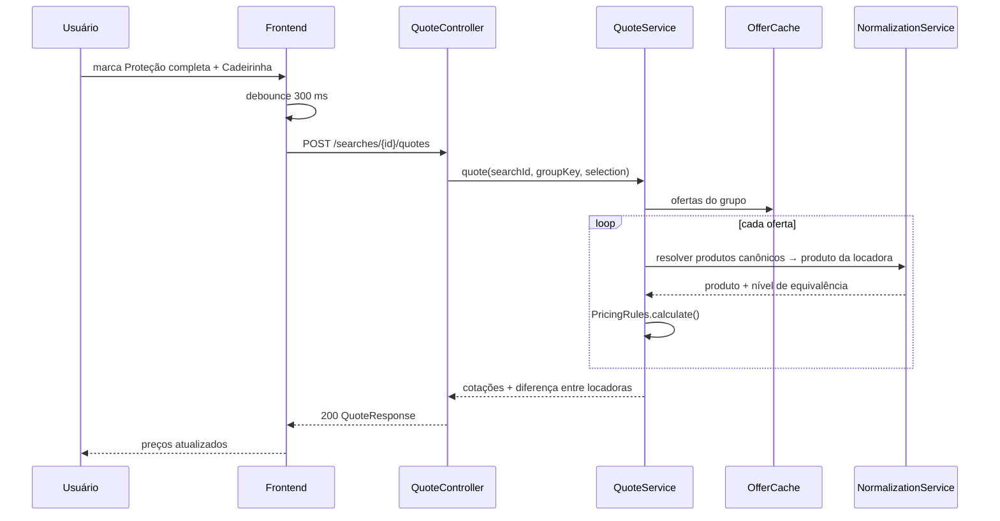

Para cada locadora, o resultado traz o detalhamento: preço original, adicionais, taxas, preço final, diferença para a mais barata e, item a item, o nível de equivalência. Se a locadora não tem um item equivalente confirmado, o item aparece como `UNAVAILABLE` ou `UNCONFIRMED` e **a oferta sai da comparação de preço** para aquela seleção (é exibida, mas sem selo e com aviso).

Se o cache expirou: `410 Gone` com código `SEARCH_EXPIRED`, e o frontend refaz a busca automaticamente.

### Trade-offs

- **Performance:** cálculo em memória, < 10 ms. O custo é a latência de rede (~50-150 ms), mitigado por debounce.
- **Escalabilidade:** o cache em memória obriga a afinidade de sessão (*sticky session*) se houver várias instâncias. Na V1 com uma instância não é problema; na escala, trocar por Redis (decisão adiada conscientemente e registrada no ADR-008).
- **Manutenção:** regra num só lugar.

### Perguntas de revisão (seção 10)

1. Que bug o `AbortController` evita? Descreva a sequência de eventos.
2. Por que cache em memória vira problema com 3 instâncias atrás de um load balancer?
3. Quando você moveria o cálculo para o frontend?

---

## 11. Contratos da API REST

### Princípios

- Base: `/api/v1`. **Versionamento na URL**: simples e visível. A alternativa (versão em header) é mais "pura" e mais difícil de testar no navegador.
- JSON em `camelCase`. Dinheiro como string decimal. Datas ISO-8601.
- Recursos com substantivos; verbos HTTP com semântica correta.
- Erros em **RFC 9457 Problem Details** (`application/problem+json`).
- Documentação gerada (springdoc-openapi) em `/v3/api-docs` e Swagger UI em `/swagger-ui`.
- Todas as respostas de busca e oferta trazem `"demo": true` enquanto os dados forem simulados.

### Visão geral

| Método | Rota | Descrição |
|---|---|---|
| GET | `/api/v1/locations?q=gru` | Autocomplete de lojas/cidades |
| POST | `/api/v1/searches` | Executa uma busca e retorna ofertas + grupos |
| GET | `/api/v1/searches/{searchId}` | Recupera uma busca em cache (refresh da página) |
| GET | `/api/v1/offers/{offerId}` | Detalhes completos de uma oferta |
| POST | `/api/v1/searches/{searchId}/quotes` | Recalcula preços de um grupo com a seleção do usuário |
| GET | `/api/v1/catalog/products` | Lista produtos canônicos (proteções, adicionais) para montar a tela de personalização |
| GET | `/api/v1/offers/{offerId}/redirect` | 302 para a página de reserva da locadora |

**Por que `POST /searches` e não `GET /offers?pickup=...`?** Uma busca tem muitos parâmetros e cria um recurso (com id, em cache, usado depois na cotação). `POST` que cria recurso é semanticamente correto. O custo: `POST` não é cacheável por CDN. Mitigação: o frontend mantém os critérios na **URL da página** (`/resultados?...`), então a página continua compartilhável; só a chamada à API é `POST`.

**Por que um endpoint de redirect?** Centraliza a montagem do link (parâmetros de afiliado no futuro), permite medir cliques (métrica de negócio) e evita expor lógica de deep link no frontend. Trade-off: um salto de rede a mais.

### `POST /api/v1/searches`

Request:

```json
{
  "pickupLocationId": "GRU-AEROPORTO",
  "dropoffLocationId": "GRU-AEROPORTO",
  "pickupAt": "2026-12-20T10:00",
  "dropoffAt": "2026-12-27T10:00",
  "driverAge": 30
}
```

Validações (seção 12): campos obrigatórios; `dropoffAt` depois de `pickupAt`; `pickupAt` não no passado; período máximo (ex.: 60 dias); `driverAge` entre 18 e 99; locais existentes. "Devolver em loja diferente" é inferido de `dropoffLocationId != pickupLocationId` (o checkbox é só interface; não duplicamos informação no contrato).

Response `201 Created` (com header `Location: /api/v1/searches/{id}`):

```json
{
  "searchId": "s_8f3a2c",
  "demo": true,
  "expiresAt": "2026-11-18T04:45:00Z",
  "criteria": {
    "pickupLocation": { "id": "GRU-AEROPORTO", "name": "Aeroporto de Guarulhos", "city": "Guarulhos", "state": "SP" },
    "dropoffLocation": { "id": "GRU-AEROPORTO", "name": "Aeroporto de Guarulhos", "city": "Guarulhos", "state": "SP" },
    "pickupAt": "2026-12-20T10:00",
    "dropoffAt": "2026-12-27T10:00",
    "driverAge": 30,
    "oneWay": false,
    "estimatedRentalDays": 7
  },
  "providers": [
    { "id": "LOCALIZA", "name": "Localiza", "status": "OK", "offerCount": 4 },
    { "id": "MOVIDA",   "name": "Movida",   "status": "OK", "offerCount": 4 },
    { "id": "UNIDAS",   "name": "Unidas",   "status": "TIMEOUT", "offerCount": 0 }
  ],
  "offers": [
    {
      "offerId": "o_LOCALIZA_7d1e",
      "provider": { "id": "LOCALIZA", "name": "Localiza", "logoUrl": "/providers/localiza.svg" },
      "vehicle": {
        "category": "COMPACT",
        "categoryLabel": "Compacto",
        "bodyType": "HATCH",
        "modelName": "Hyundai HB20 ou similar",
        "imageUrl": "/vehicles/compact-hatch.png",
        "transmission": "MANUAL",
        "airConditioning": true,
        "passengers": 5,
        "luggage": { "large": 1, "small": 1 }
      },
      "rentalDays": 7,
      "dailyRate": { "amount": "119.90", "currency": "BRL" },
      "basePrice": { "amount": "839.30", "currency": "BRL" },
      "fees": [
        { "code": "ADMIN_FEE", "label": "Taxa administrativa", "amount": { "amount": "100.71", "currency": "BRL" } }
      ],
      "totalPrice": { "amount": "940.01", "currency": "BRL" },
      "includedProtection": {
        "canonicalCode": "PROTECTION_BASIC",
        "providerName": "Proteção Básica",
        "equivalence": "CONFIRMED"
      },
      "mileage": { "type": "UNLIMITED" },
      "groupKey": "g_COMPACT_MANUAL_AC_5_UNLIMITED_PROTECTION_BASIC",
      "bookingAvailable": true
    }
  ],
  "groups": [
    {
      "groupKey": "g_COMPACT_MANUAL_AC_5_UNLIMITED_PROTECTION_BASIC",
      "offerIds": ["o_LOCALIZA_7d1e", "o_MOVIDA_a91b"],
      "result": "WINNER",
      "bestOfferId": "o_LOCALIZA_7d1e",
      "savings": { "amount": "42.30", "currency": "BRL" },
      "comparedProviders": ["LOCALIZA", "MOVIDA"]
    }
  ],
  "filters": {
    "categories": ["ECONOMY", "COMPACT", "SEDAN", "SUV"],
    "bodyTypes": ["HATCH", "SEDAN", "SUV"],
    "transmissions": ["MANUAL", "AUTOMATIC"],
    "passengers": [4, 5, 7]
  }
}
```

`result` pode ser `WINNER`, `TIE` ou `NO_COMPARISON`. `filters` traz as facetas disponíveis para montar os filtros; a **filtragem em si acontece no frontend** (são poucas dezenas de ofertas, e filtrar localmente é instantâneo). Se o volume crescer, os filtros viram parâmetros da API.

### `GET /api/v1/offers/{offerId}`

Tudo do card, mais: `protections[]` (incluídas e opcionais, cada uma com `coverages[]`, `deductible` e `equivalence`), `addons[]` disponíveis com preço e unidade, `fuelPolicy` (`FULL_TO_FULL`...), `cancellationPolicy` (opcional, texto + prazos), `bookingUrl` (via redirect), `disclaimer`.

### `POST /api/v1/searches/{searchId}/quotes`

Request:

```json
{
  "groupKey": "g_COMPACT_MANUAL_AC_5_UNLIMITED_PROTECTION_BASIC",
  "protection": "PROTECTION_FULL",
  "addons": [
    { "code": "ADDON_CHILD_SEAT", "quantity": 1 },
    { "code": "ADDON_EXTRA_DRIVER", "quantity": 1 }
  ],
  "mileage": "MILEAGE_UNLIMITED"
}
```

Response `200`:

```json
{
  "searchId": "s_8f3a2c",
  "demo": true,
  "quotes": [
    {
      "offerId": "o_LOCALIZA_7d1e",
      "provider": "LOCALIZA",
      "comparable": true,
      "breakdown": {
        "basePrice":   { "amount": "839.30", "currency": "BRL" },
        "protections": { "amount": "280.00", "currency": "BRL" },
        "addons":      { "amount": "245.00", "currency": "BRL" },
        "fees":        { "amount": "100.71", "currency": "BRL" },
        "total":       { "amount": "1465.01", "currency": "BRL" }
      },
      "items": [
        { "code": "PROTECTION_FULL",   "providerName": "Proteção Super", "equivalence": "CONFIRMED", "price": { "amount": "280.00", "currency": "BRL" } },
        { "code": "ADDON_CHILD_SEAT",  "providerName": "Cadeirinha",     "equivalence": "CONFIRMED", "price": { "amount": "140.00", "currency": "BRL" } },
        { "code": "ADDON_EXTRA_DRIVER","providerName": "Condutor extra", "equivalence": "CONFIRMED", "price": { "amount": "105.00", "currency": "BRL" } }
      ],
      "differenceToCheapest": { "amount": "0.00", "currency": "BRL" }
    },
    {
      "offerId": "o_MOVIDA_a91b",
      "provider": "MOVIDA",
      "comparable": false,
      "notComparableReason": "PROTECTION_FULL sem equivalência confirmada nesta locadora",
      "breakdown": { "...": "..." },
      "items": [
        { "code": "PROTECTION_FULL", "providerName": "Proteção Total", "equivalence": "UNCONFIRMED", "price": { "amount": "245.00", "currency": "BRL" } }
      ],
      "differenceToCheapest": null
    }
  ],
  "bestOfferId": "o_LOCALIZA_7d1e",
  "savings": null
}
```

### Códigos de status

| Status | Quando |
|---|---|
| 200 / 201 | Sucesso |
| 400 | JSON malformado / tipo errado |
| 404 | `offerId` ou `locationId` inexistente |
| 410 | Busca expirada (`SEARCH_EXPIRED`) |
| 422 | Validação de negócio (datas, idade) |
| 502 | Todas as locadoras falharam (`ALL_PROVIDERS_FAILED`) |
| 500 | Erro inesperado (nunca vaza stack trace) |

> Falha **parcial** de locadoras não é erro HTTP: é `201` com `status` por locadora. Erro HTTP é para quando a requisição como um todo não pôde ser atendida.

### Perguntas de revisão (seção 11)

1. Por que 422 e não 400 para "devolução antes da retirada"? (Há quem use 400 para ambos: defenda sua escolha.)
2. Por que a filtragem fica no frontend nesta versão? O que te faria mudar?
3. Por que o contrato não tem um campo `differentReturnStore`?
4. Quando uma locadora falha, por que a resposta ainda é 201?

---

## 12. DTOs, validação e tratamento padronizado de erros

### DTOs

**Teoria:** DTO (Data Transfer Object) é um objeto que existe só para atravessar uma fronteira (HTTP, fila). Ele protege o domínio de mudanças no contrato e vice-versa. Expor entidade JPA no controller é o erro clássico: qualquer coluna nova muda a API, relacionamentos *lazy* explodem na serialização e o cliente pode enviar campos que você não queria (*mass assignment*).

Fluxo de tipos:

```
JSON → SearchRequest (DTO, api) → SearchCriteria (domínio) → ProviderQuery (provider.core)
     → LocalizaRequest (DTO da locadora) → ... → ProviderOffer → Offer (domínio) → OfferResponse (DTO, api) → JSON
```

Muitos tipos, sim. Cada fronteira tem seu modelo para que mudanças não se propaguem. Mapeamento manual com métodos estáticos (`OfferResponse.from(offer)`) é explícito e fácil de depurar. MapStruct é uma boa opção quando os mapeamentos ficarem repetitivos (gera código em tempo de compilação, sem reflexão).

DTOs como `record` (imutáveis, `equals`/`hashCode`/`toString` prontos):

```java
public record SearchRequest(
        @NotBlank String pickupLocationId,
        @NotBlank String dropoffLocationId,
        @NotNull @FutureOrPresent LocalDateTime pickupAt,
        @NotNull LocalDateTime dropoffAt,
        @NotNull @Min(18) @Max(99) Integer driverAge) {

    @AssertTrue(message = "A devolução deve ser depois da retirada.")
    boolean isDropoffAfterPickup() {
        return pickupAt == null || dropoffAt == null || dropoffAt.isAfter(pickupAt);
    }
}
```

Validação em duas camadas:

- **Formato e campos** (Bean Validation, no DTO): obrigatório, faixa, formato.
- **Regras de negócio** (no domínio ou serviço): local existe, período máximo, locadora aceita a idade. Regras de negócio não pertencem a anotações, porque precisam de dados e de contexto.

### Erros padronizados (RFC 9457)

Todo erro tem o mesmo formato, para o frontend tratar de forma genérica:

```json
{
  "type": "https://rentou.app/errors/validation",
  "title": "Dados de pesquisa inválidos",
  "status": 422,
  "detail": "Revise os campos destacados.",
  "instance": "/api/v1/searches",
  "code": "VALIDATION_ERROR",
  "traceId": "4bf92f3577b34da6",
  "errors": [
    { "field": "dropoffAt", "message": "A devolução deve ser depois da retirada." }
  ]
}
```

```java
public enum ErrorCode {
    VALIDATION_ERROR(422), LOCATION_NOT_FOUND(404), OFFER_NOT_FOUND(404),
    SEARCH_EXPIRED(410), ALL_PROVIDERS_FAILED(502), INTERNAL_ERROR(500);
    // status HTTP associado
}

public class ApiException extends RuntimeException {
    private final ErrorCode code;
    // ...
}

@RestControllerAdvice
class GlobalExceptionHandler {
    @ExceptionHandler(MethodArgumentNotValidException.class)
    ProblemDetail onValidation(MethodArgumentNotValidException ex) { /* monta errors[] */ }

    @ExceptionHandler(ApiException.class)
    ProblemDetail onApi(ApiException ex) { /* usa ex.code() */ }

    @ExceptionHandler(Exception.class)
    ProblemDetail onUnexpected(Exception ex) {
        log.error("Erro inesperado", ex);            // stack trace só no log
        return problem(ErrorCode.INTERNAL_ERROR, "Algo deu errado. Tente novamente.");
    }
}
```

`code` é estável e pensado para máquinas (o frontend decide o que fazer com base nele). `title` e `detail` são para humanos e podem mudar. `traceId` liga o erro na tela ao log no servidor.

### Erros comuns

- Usar exceções para controle de fluxo normal ("locadora sem carros" não é exceção, é lista vazia).
- Um `catch (Exception e)` em cada controller: duplicação e formatos inconsistentes.
- Vazar mensagem interna (`"could not execute statement; SQL [n/a]"`) para o usuário.

### Perguntas de revisão (seção 12)

1. Liste três problemas de expor uma entidade JPA diretamente na API.
2. Por que "locadora existe" não é uma anotação `@ValidLocation` no DTO? (Há quem faça assim. Quais os custos?)
3. Para que serve `code` se já temos `status`?

---

## 13. Modelo de dados (PostgreSQL)

### O que persistir (e o que não)

**Teoria:** banco relacional é para dados que precisam de durabilidade, integridade e consulta. Preço de aluguel é volátil (muda por minuto) e pertence à locadora. Guardar preço como verdade seria criar um cache desatualizado com cara de dado oficial.

| Persistir no PostgreSQL | Não persistir (cache/memória) |
|---|---|
| Locadoras e metadados | Ofertas e preços de uma busca (cache com TTL) |
| Lojas/locais (para autocomplete e validação) | Cotações |
| Catálogo canônico | |
| Definições de produtos das locadoras + mapeamentos (com auditoria) | |
| Mapeamento de categorias de veículo | |
| Log de buscas e cliques de redirecionamento (analytics, sem dados pessoais) | |

### Diagrama ER

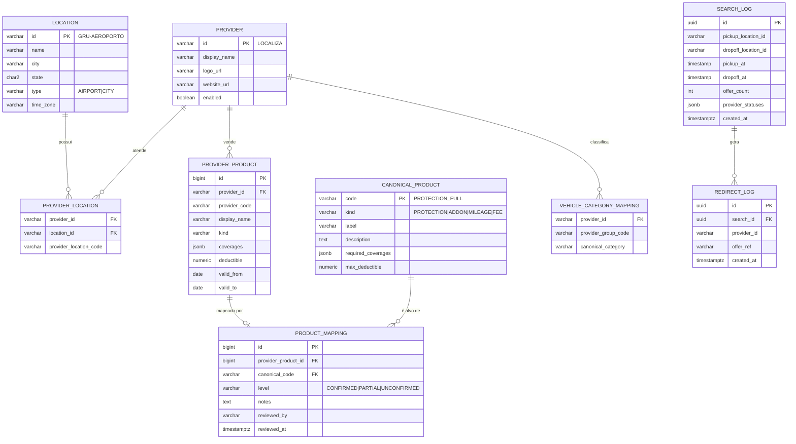

Decisões:

- **Migrações com Flyway** (`V1__create_catalog.sql`...). Nunca `ddl-auto=update` fora do desenvolvimento local: ele não remove colunas, não migra dados e não é revisável em PR.
- `UNIQUE (provider_id, provider_code, valid_from)` em `provider_product`; `UNIQUE (provider_product_id)` em `product_mapping` (um produto mapeia para no máximo um canônico).
- `jsonb` para `coverages`: lista flexível, que muda com frequência e é lida inteira. Trade-off: menos integridade que uma tabela `coverage` normalizada. Se precisarmos consultar "todos os produtos que cobrem vidros", normalizamos.
- Índices: `location(city)` e um índice de trigramas (`pg_trgm`) em `location(name)` para autocomplete com `ILIKE`.
- `SEARCH_LOG` não guarda idade nem dado pessoal. Princípio de minimização da LGPD: só coletar o necessário.
- JPA: entidades só dentro de `infra/`, `FetchType.LAZY` por padrão, `open-in-view: false` (evita consultas escondidas na serialização) e leitura do catálogo com cache em memória, recarregado periodicamente.

### Perguntas de revisão (seção 13)

1. Por que não guardamos os preços das ofertas no banco?
2. Quando `jsonb` é uma má escolha?
3. O que `spring.jpa.open-in-view=false` evita?
4. Por que Flyway e não `ddl-auto=update`?

---

## 14. Dados simulados (modo demonstração)

### Requisitos

- Exercitar o fluxo completo (busca, filtros, selo, personalização, detalhes, redirecionamento).
- Cada locadora deve ganhar em algumas situações.
- Deixar claro que é demonstração.
- Ser **determinístico**: a mesma busca dá o mesmo resultado (para testes e demos reproduzíveis).

### Decisão: motor de cenários

```java
public final class MockScenarioEngine {
    /** Semente derivada dos critérios: mesma busca → mesmos preços. */
    long seedFor(ProviderQuery q) { return Objects.hash(q.pickupLocation(), q.pickupAt().toLocalDate(), q.rentalDays()); }
}
```

Cenários desenhados (regras sobre preços-base fictícios por categoria):

| Cenário | Gatilho | Quem ganha |
|---|---|---|
| Aeroporto, curta duração (≤ 3 diárias) | `location.type == AIRPORT` e dias ≤ 3 | Localiza |
| Longa duração (≥ 7 diárias) | dias ≥ 7 | Movida (desconto progressivo fictício) |
| SUV e automáticos | categoria SUV ou câmbio automático | Unidas |
| Devolução em outra loja | `oneWay` | Varia: cada locadora com taxa diferente |
| Item sem equivalência | Sempre: uma locadora tem uma "Proteção Total" fictícia com franquia diferente → `PARTIAL`/`UNCONFIRMED` | Demonstra o aviso |
| Wi-Fi | Só uma locadora oferece | Demonstra "indisponível" |
| Falha simulada | Local `TEST-TIMEOUT` | Uma locadora retorna timeout, demonstra resultado parcial |

Os dados ficam em arquivos JSON por locadora (`src/main/resources/mock/localiza/*.json`) **no formato que imaginamos para a resposta da locadora**, e passam pelo `LocalizaMapper` real (seção 5).

### Transparência

- Toda resposta tem `"demo": true`.
- O frontend mostra uma faixa fixa: "Modo demonstração: os preços são fictícios e não representam ofertas reais das locadoras."
- Os botões "Ver oferta" e "Continuar na locadora" levam à página inicial pública da locadora, nunca a uma reserva simulada no Rentou.

### Marcas das locadoras

Logos e nomes são marcas registradas. Para apresentar ao mercado, o uso deve ser autorizado (normalmente parte do acordo comercial). Até lá, usar o nome em texto com identificador visual neutro (iniciais em círculo colorido) e registrar isso como pendência de produto.

### Perguntas de revisão (seção 14)

1. Por que os dados simulados passam pelo mapper real?
2. Por que determinismo importa num mock?
3. Por que o modo demonstração precisa aparecer no contrato da API, e não só no frontend?

---

## 15. Integrações oficiais futuras

### Premissas

- **Não presumir APIs públicas.** Integração só com credenciais e autorização comercial (programa de parceiros/afiliados ou API B2B).
- **Não fazer scraping** dos sites: viola termos de uso, é frágil e expõe o projeto juridicamente.

### O que o adaptador oficial precisa ter

| Preocupação | Como |
|---|---|
| Credenciais | Variáveis de ambiente ou secret manager (AWS Secrets Manager futuramente). Nunca no repositório |
| Cliente HTTP | `RestClient` do Spring com timeouts de conexão e leitura explícitos |
| Resiliência | Resilience4j: **timeout**, **retry** com backoff só para erros transitórios e operações idempotentes, **circuit breaker** (para de chamar uma locadora que está caindo, protegendo ela e nós), **bulkhead** (limita chamadas concorrentes por locadora) |
| Limite de taxa | Respeitar o rate limit contratado; cache de resultados por (local, datas) com TTL curto |
| Contrato | Testes de contrato com stubs (WireMock) gravados a partir da documentação oficial |
| Mapeamento | Novos códigos de produto caem automaticamente em `UNCONFIRMED` até revisão |
| Observabilidade | Métricas por locadora: latência, taxa de erro, estado do circuit breaker, produtos não mapeados |
| Feature flag | `mode: official` por locadora, permitindo ativar uma de cada vez |

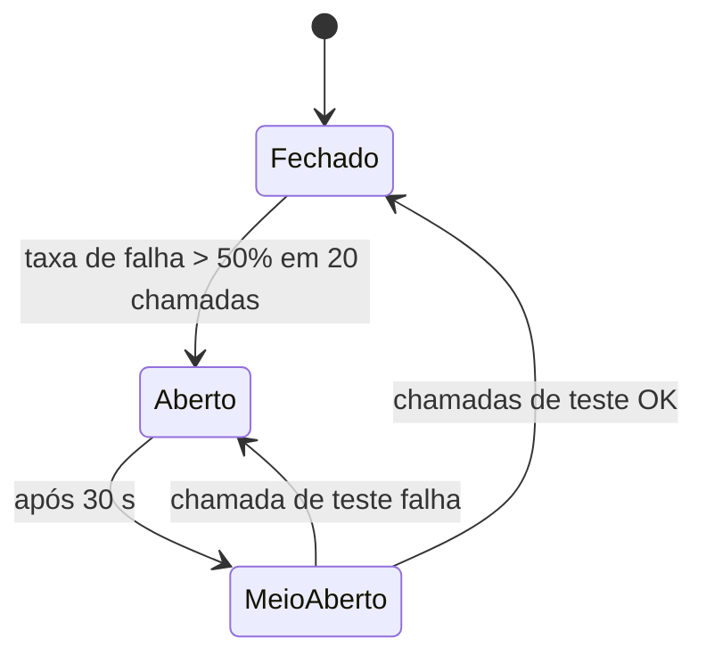

### Adicionando uma quarta locadora (checklist)

1. Criar o pacote `provider/novalocadora` com `NovaLocadoraProvider implements RentalProvider`, `Source`, `Mapper`, `Properties`.
2. Inserir a linha em `provider` (migração Flyway) e os mapeamentos de lojas, categorias e produtos.
3. Configurar `rentou.providers.novalocadora.*`.
4. Escrever testes do mapper e de contrato.
5. **Nenhuma alteração** em `search`, `comparison` ou `quote`. Se precisar alterar, a abstração está vazando: pare e revise.

### Perguntas de revisão (seção 15)

1. Por que retry só para operações idempotentes?
2. O que o circuit breaker protege além do Rentou?
3. Qual o sinal de que a abstração `RentalProvider` está errada ao adicionar a quarta locadora?

---

## 16. Arquitetura do frontend

> O frontend está sendo construído em paralelo neste repositório. Esta seção define as fronteiras e o contrato; os detalhes de componentes seguem o que for implementado lá.

### Stack

Next.js (App Router) + React + TypeScript (`strict: true`) + Tailwind CSS + Lucide Icons + fonte Inter (`next/font`).

### Rotas

| Rota | Tela | Estado principal |
|---|---|---|
| `/` | Home + formulário | Formulário local |
| `/resultados?pickup=GRU-AEROPORTO&dropoff=GRU-AEROPORTO&pickupAt=2026-12-20T10:00&dropoffAt=2026-12-27T10:00&age=30` | Resultados + filtros + painel de personalização | **Critérios na URL**; filtros também na URL (`&transmission=AUTOMATIC`) |
| `/oferta/[offerId]` | Detalhes | `offerId` na URL |

**URL como fonte de estado** da busca: a página pode ser recarregada, compartilhada e o botão "voltar" funciona. É o que o Google Flights faz. Trade-off: parsing e validação de query string (feito com o mesmo schema do formulário).

### Estrutura de pastas sugerida

```
rentou-frontend/src/
├── app/                      # rotas (App Router)
│   ├── page.tsx              # Home
│   ├── resultados/page.tsx
│   └── oferta/[offerId]/page.tsx
├── components/
│   ├── ui/                   # Button, Input, Badge, Skeleton, Card (genéricos)
│   ├── search/               # SearchForm, LocationAutocomplete, DateTimeField
│   ├── results/              # OfferCard, FiltersPanel, ResultsHeader, BestOfferBadge,
│   │                         # ProviderStatusBanner, EmptyState
│   ├── customize/            # CustomizePanel, ProtectionPicker, AddonPicker, PriceBreakdown
│   └── layout/               # Header, Footer, DemoBanner
├── lib/
│   ├── api/
│   │   ├── types.ts          # gerado do OpenAPI (ou espelhado à mão até o backend existir)
│   │   ├── rentou-api.ts     # interface RentouApi
│   │   ├── http-api.ts       # implementação real (fetch)
│   │   └── mock-api.ts       # implementação mock local (enquanto não há backend)
│   ├── format/               # formatMoney (pt-BR, BRL), formatDate, formatPeriod
│   ├── validation/           # schema do formulário (zod), usado na Home e na URL
│   └── search-params.ts      # serializa/desserializa critérios <-> URL
└── hooks/                    # useSearch, useQuote (debounce + AbortController)
```

A interface `RentouApi` no frontend é o **mesmo padrão de portas e adaptadores** do backend: a interface não muda quando trocamos o mock pelo HTTP real. Seleção por variável de ambiente (`NEXT_PUBLIC_API_MODE=mock|http`).

### Server vs Client Components

- Server Components por padrão (layout, conteúdo estático, cabeçalho).
- Client Components só onde há interação: formulário, filtros, painel de personalização.
- Trade-off: buscar dados no servidor (Next como BFF) esconde a URL do backend e melhora o primeiro carregamento, mas adiciona um salto de rede. Recomendação inicial: busca no cliente com skeleton (mais simples, e os resultados são dinâmicos por natureza); reavaliar SSR quando houver SEO de páginas por cidade.

### Experiência

- Skeleton dos cards durante a busca; skeleton só no preço durante a cotação.
- Estados explícitos para cada tela: `loading | success | partial | empty | error`. Um tipo union discriminado em TypeScript torna impossível esquecer um estado.
- Mensagens a partir do `code` do erro, nunca do texto técnico.
- Acessibilidade: labels em todos os campos, foco visível, contraste AA (o verde da economia precisa passar no contraste sobre branco), selo de "Melhor oferta" com texto, não só cor.

### Perguntas de revisão (seção 16)

1. Por que guardar os critérios da busca na URL?
2. Como a interface `RentouApi` repete a ideia do `RentalProvider`?
3. Qual a vantagem de um union discriminado para os estados da tela?

---

## 17. Estratégia de testes

**Teoria:** a **pirâmide de testes** recomenda muitos testes rápidos e isolados na base (unitários), menos testes de integração e poucos testes ponta a ponta (lentos e frágeis). A ideia é ter feedback rápido onde está a lógica.

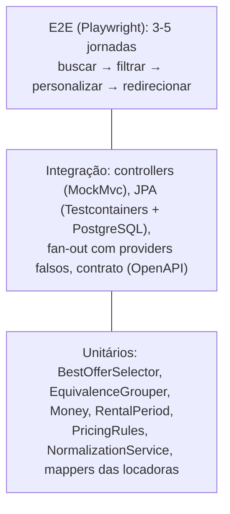

| Alvo | Tipo | Ferramenta | Foco |
|---|---|---|---|
| `BestOfferSelector`, `EquivalenceGrouper` | Unitário parametrizado | JUnit 5 `@ParameterizedTest` | Empates, grupo único, `UNCONFIRMED`, locadora ausente |
| `Money`, `PricingRules` | Unitário (+ property-based com jqwik) | JUnit, jqwik | "Total = soma das linhas" para qualquer entrada |
| Mappers | Unitário com JSON de exemplo | JUnit | Códigos desconhecidos viram `UNCONFIRMED` |
| `ProviderFanOut` | Integração leve | Providers falsos que demoram/falham | Timeout, resultado parcial, cancelamento |
| Controllers | Slice | `@WebMvcTest` + MockMvc | Validação, status, formato Problem Details |
| Repositórios | Integração | `@DataJpaTest` + Testcontainers | Migrações Flyway e consultas reais no PostgreSQL |
| Arquitetura | Regra | ArchUnit | `domain` sem Spring; ninguém importa `provider.localiza` |
| Contrato | Contrato | OpenAPI gerado + validação no CI | Frontend e backend falam a mesma língua |
| Frontend | Unitário/componente | Vitest + Testing Library | Formatação R$, estados da tela, debounce |
| Jornadas | E2E | Playwright | Fluxo completo em modo demo |

Exemplo de regra ArchUnit:

```java
@ArchTest
static final ArchRule domainIsFrameworkFree = noClasses()
    .that().resideInAPackage("..domain..")
    .should().dependOnClassesThat().resideInAnyPackage("org.springframework..", "jakarta.persistence..");
```

**Erros comuns:** testar só o caminho feliz; mockar tudo (o teste passa a verificar o mock, não o código); usar H2 no lugar do PostgreSQL (o SQL difere e o teste mente).

### Perguntas de revisão (seção 17)

1. Por que H2 é uma armadilha para testar um sistema que roda em PostgreSQL?
2. Qual propriedade você testaria com property-based testing no `PricingRules`?
3. O que o ArchUnit protege que um code review humano esquece?

---

## 18. Requisitos transversais: segurança, observabilidade, performance

### Segurança (V1 sem login)

- CORS restrito à origem do frontend.
- Validação de toda entrada; limites de tamanho de requisição.
- Rate limiting por IP na busca (Bucket4j ou no gateway/CDN), já que cada busca gera chamadas pagas ou limitadas às locadoras.
- Endpoint de redirect só redireciona para domínios da lista permitida (evita *open redirect*, usado em phishing).
- Cabeçalhos de segurança (CSP, HSTS) no frontend.
- Dependências verificadas no CI (Dependabot, OWASP Dependency-Check).
- Sem dados pessoais na V1; quando houver conta de usuário, entra o módulo de Spring Security.

### Observabilidade

Os três pilares: **logs** (o que aconteceu), **métricas** (quanto/quão rápido), **traces** (por onde passou).

- Spring Boot Actuator (`/actuator/health`, `/actuator/prometheus`).
- Logs estruturados em JSON com `traceId` (o mesmo que vai no Problem Details).
- Métricas de negócio com Micrometer: `rentou.search.duration`, `rentou.provider.latency{provider}`, `rentou.provider.errors{provider,status}`, `rentou.catalog.unmapped{provider}`, `rentou.redirect.clicks{provider}`.
- Tracing com OpenTelemetry quando houver integrações reais.

### Performance e escalabilidade

- Backend stateless, exceto pelo cache de busca (ver ADR-008 para o caminho até Redis).
- Catálogo e mapeamentos carregados em memória.
- Cache de resultados por locadora com chave (local, datas, idade) e TTL curto (ex.: 2-5 min) quando houver APIs reais, reduzindo custo e rate limit.
- Compressão HTTP (gzip/br) na resposta da busca.

### Perguntas de revisão (seção 18)

1. O que é *open redirect* e por que o endpoint de redirect precisa de lista permitida?
2. Qual métrica te avisaria primeiro que uma locadora mudou os códigos de produto?

---

## 19. Roadmap em fases

Cada fase termina com algo demonstrável. Para o seu estudo, cada fase também conecta com módulos da sua trilha (entre colchetes).

| Fase | Entrega | Critério de pronto | Trilha |
|---|---|---|---|
| **0. Fundação** (1 semana) | Pastas `rentou-frontend/` e `rentou-backend/`, CI (lint, build, testes), Docker Compose com PostgreSQL, Flyway, OpenAPI vazio, ADRs | `docker compose up` sobe tudo; CI verde | Docker, CI/CD |
| **1. Frontend com mock local** (1-2 semanas, em andamento) | Home, Resultados, Personalização, Detalhes usando `mock-api.ts` | Fluxo completo navegável; responsivo; faixa de demonstração | React/TS |
| **2. Backend: busca** (2 semanas) | `RentalProvider` + 3 adaptadores mock + fan-out + `POST /searches` + erros padronizados | Testes unitários do comparador; MockMvc; ArchUnit | OOP, SOLID, Collections, Streams, Concorrência, Spring Boot, REST |
| **3. Normalização e cotação** (2 semanas) | Catálogo no banco, mapeamentos, níveis de equivalência, `POST /quotes`, detalhes da oferta | Cenários de cada locadora ganhando; itens `UNCONFIRMED` aparecem corretamente | JPA/Hibernate, SQL, DDD |
| **4. Integração front + back** (1 semana) | Frontend troca `mock-api` por `http-api`; tipos gerados do OpenAPI; teste de contrato | E2E Playwright verde contra o backend | Testes de integração |
| **5. Produção** (1-2 semanas) | Deploy (ex.: frontend na Vercel, backend em container na AWS com RDS), observabilidade, rate limiting | Health checks, dashboards, alertas | AWS, Observabilidade |
| **6. Primeira integração oficial** (depende de acordo) | `mode: official` para uma locadora, com Resilience4j e WireMock | Circuit breaker testado; produtos novos caem em `UNCONFIRMED` | Sistemas distribuídos |
| **7. Evoluções** | Resultados em streaming (SSE), Redis, alertas de preço (mensageria com SQS/SNS ou Kafka), contas de usuário (Spring Security) | Por demanda | Mensageria, EDA, Security |

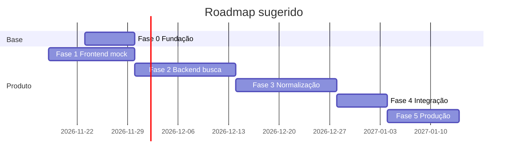

As datas são estimativas para estudo em tempo parcial. Ajuste ao seu ritmo: o objetivo é aprender bem, não terminar rápido.

---

## 20. Registro de decisões (ADRs)

**ADR (Architecture Decision Record)** é um texto curto que registra uma decisão, seu contexto e suas consequências. Existe porque daqui a um ano ninguém lembra *por que* algo foi feito, e decisões sem contexto ou são repetidas ou revertidas sem querer. Sugestão: um arquivo por ADR em `docs/adr/`.

| ADR | Decisão | Status |
|---|---|---|
| 001 | Frontend e backend como projetos independentes (pastas com build e CI próprios no mesmo repo), ligados por OpenAPI | Aceita |
| 002 | Backend como monólito modular, package by feature | Aceita |
| 003 | `RentalProvider` como porta; adaptadores com `Source` + `Mapper` (ACL) | Aceita |
| 004 | Fan-out com virtual threads, timeout global e resultados parciais | Aceita |
| 005 | Catálogo canônico com mapeamento revisado e três níveis de equivalência; ausência = `UNCONFIRMED` | Aceita |
| 006 | Melhor oferta só dentro de grupo equivalente com 2+ locadoras; economia vs. 2º menor preço | Aceita |
| 007 | `Money` com `BigDecimal` e `HALF_EVEN`; dinheiro como string no JSON | Aceita |
| 008 | Cotação calculada no backend; ofertas em cache em memória (Caffeine) com TTL; migrar para Redis ao escalar horizontalmente | Aceita, revisar na Fase 5 |
| 009 | Erros em RFC 9457 com `code` estável | Aceita |
| 010 | Preços não são persistidos; banco guarda catálogo, lojas, mapeamentos e logs anônimos | Aceita |
| 011 | Sem scraping; integrações só oficiais | Aceita |

Modelo de ADR:

```markdown
# ADR-00X: Título
## Contexto
O que está acontecendo e quais forças estão em jogo.
## Decisão
O que decidimos.
## Alternativas
O que mais foi considerado e por que não.
## Consequências
O que fica mais fácil, o que fica mais difícil, o que precisaremos revisar.
```

---

## 21. Avaliação final do módulo

Responda por escrito (de preferência em um arquivo seu, para revisarmos juntos). Não consulte o documento na primeira tentativa: o objetivo é descobrir o que você realmente fixou.

### A. Perguntas conceituais

1. Explique a diferença entre monólito modular e microsserviços em termos de custo operacional. Por que começamos com o monólito?
2. Explique, com exemplos do Rentou, DIP, OCP, LSP e ISP.
3. O que é uma Anti-Corruption Layer e onde ela está no Rentou?
4. Por que equivalência baseada em nome é perigosa? Que mecanismo substitui isso?
5. Explique o fluxo completo de uma busca, do clique em "Comparar preços" até o selo na tela.

### B. Análise de código

O que está errado aqui? Liste todos os problemas.

```java
@RestController
public class SearchController {
    @Autowired LocalizaClient localiza;
    @Autowired MovidaClient movida;
    @Autowired UnidasClient unidas;

    @PostMapping("/search")
    public List<OfferEntity> search(@RequestBody Map<String, Object> body) {
        List<OfferEntity> all = new ArrayList<>();
        all.addAll(localiza.search(body));
        all.addAll(movida.search(body));
        all.addAll(unidas.search(body));
        OfferEntity best = all.stream().min(comparing(OfferEntity::getDailyPrice)).get();
        best.setBestOffer(true);
        return all;
    }
}
```

(Dica: há pelo menos dez problemas, cobrindo SOLID, concorrência, contrato, dinheiro, corretude de negócio e tratamento de erro.)

### C. Debugging

Um usuário reclama: "O Rentou disse que a Movida era a melhor oferta, mas no site da Movida o carro não tinha a proteção que eu escolhi." Quais componentes você investigaria, em que ordem, e que dados (logs, métricas, tabelas) usaria?

### D. Refatoração

Reescreva o controller do item B seguindo a arquitetura deste documento. Você não precisa de todas as classes, mas os nomes e responsabilidades devem estar corretos.

### E. Problema real (design)

A Unidas passa a exigir que cada busca seja feita em duas etapas: primeiro uma chamada de disponibilidade, depois uma chamada de preço por categoria (uma chamada por categoria). Como isso afeta:

1. O contrato `RentalProvider`? (Deve mudar?)
2. O tempo de resposta da busca?
3. O timeout e o paralelismo dentro do adaptador?

### F. Mini-projeto prático (para fazer no backend da Fase 2)

Implemente, com testes, sem Spring:

1. `Money` (com `plus`, `minus`, `times`, arredondamento `HALF_EVEN`).
2. `EquivalenceKey` e `EquivalenceGrouper`.
3. `BestOfferSelector` com os seis casos: grupo único, duas locadoras, três locadoras, empate, oferta `UNCONFIRMED`, todas da mesma locadora.

Critério de aprovação: todos os testes passam e você consegue explicar cada decisão sem olhar o código.

---

*Próximo passo sugerido:* fazer a avaliação acima antes de começarmos a Fase 2 (backend). Ela cobre exatamente os conceitos que você vai implementar.
